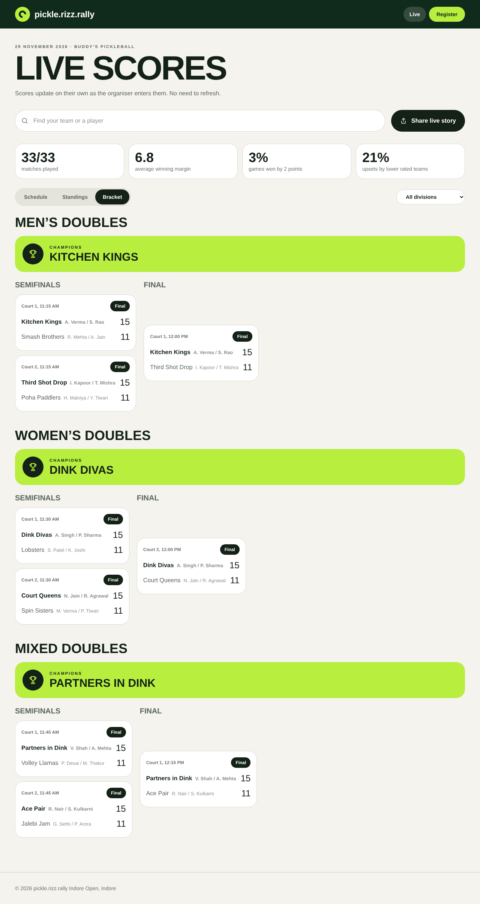

# pickle.rizz.rally Indore Open

Website for a doubles pickleball tournament at Buddy's Pickleball, Indore, on 29 November 2026. Players register and follow live scores on their phones, the organiser runs the whole day from one dashboard, and every update reaches every open phone in about a second.

**Live site:** `https://arnav2293-afk.github.io/pickle-rizz-rally/`


## What it does

| For | Features |
|---|---|
| Players | Team registration with UPI payment reference, live schedule with "On court now" and "Next up", pool standings, knockout bracket, team search, a page per team showing their next court and time |
| Organiser | Login, approve or reject registrations, WhatsApp confirmations, walk-in teams, check-in, schedule generator, score entry with rule checks, automatic knockout bracket |
| Instagram | One tap creates a 1080 x 1920 story poster (starburst sticker, marquee band, ticket stub with QR code): registrations open, last few spots, schedule dropped, live now, team results, champions |
| Payments | UPI pay button that opens GPay, PhonePe or Paytm with the amount filled in on phones, and a scannable UPI QR on laptops |

## How it works

**Stack:** React 19, TypeScript, Tailwind CSS v4, Vite, Firebase (Firestore and Authentication), GitHub Pages with GitHub Actions.

**Live data.** The whole tournament lives in one Firestore document. Every phone holds one live listener on it, so each score change costs one write and one read per viewer, which keeps a busy day well inside the free tier. Phone numbers and emails sit in a separate collection that only organisers can read.

**No overwrites.** Every organiser change runs inside a Firestore transaction, so two organisers entering scores on different courts at the same moment never wipe each other's work.

**Scheduling engine** (`src/lib/tournament.ts`, pure TypeScript with no UI code):

1. *Snake seeding* deals teams into pools by skill (A, B, C, then C, B, A) so every pool has one strong team.
2. *Circle method round robin* creates every pairing in each pool exactly once.
3. *Greedy court packer* fills every court in every slot, preferring matches where neither team played the slot before. On 24 test teams and the venue's 2 courts it packed 30 matches into 15 slots with zero back-to-back games.
4. *Standings* rank by wins, then head to head when exactly two teams are level, then point difference, then points scored.
5. *Knockout seeding* uses standard bracket order, gives byes to top seeds, and swaps first-round opponents to avoid same-pool rematches. Rounds are timed backwards from the final, so every final lands in the last block of the day.

**Built not to crash.** The page shows the last scores if a player loses signal at the court, falls back to memory storage in in-app browsers that block storage, shows a reload message instead of a blank screen if anything fails, and validates every registration in the security rules.



## Setup

### 1. Firebase (free plan)

1. Go to console.firebase.google.com, click **Create a project**, name it, turn off Analytics, click **Create project**
2. **Build** > **Firestore Database** > **Create database** > location **asia-south1 (Mumbai)** > **Start in production mode** > **Create**
3. **Build** > **Authentication** > **Get started** > **Email/Password** > **Enable** > **Save**
4. **Users** tab > **Add user** with the organiser email and a strong password. Copy the **User UID** shown in the list
5. **Firestore Database** > **Rules** tab: paste the contents of `firestore.rules`, replace `PASTE_YOUR_UID_HERE` with that UID, click **Publish**
6. Gear icon > **Project settings** > **Your apps** > **</>** (web) > register the app > copy the `firebaseConfig` values into `src/config.ts`
7. **Authentication** > **Settings** > **Authorized domains** > **Add domain** > `arnav2293-afk.github.io`

### 2. Event details

Edit `src/config.ts`: UPI ID, entry fee, venue address, Instagram handle, WhatsApp number, registration deadline. If you move the repo to another GitHub account, update the username in the `og:image` line of `index.html` so link previews keep working.

### 3. Deploy to GitHub Pages

1. Create a public repo named `pickle-rizz-rally` and upload every file in this folder (keep the `.github` folder)
2. Repo **Settings** > **Pages** > **Source**: **GitHub Actions**
3. Any push to `main` builds and publishes the site. Watch progress in the **Actions** tab

If you name the repo something else, the workflow adapts on its own.

### Run locally

```
npm install
npm run dev
```

## Pages

| Link | What it is |
|---|---|
| `/` | Tournament home and registration |
| `#/live` | Schedule, standings, bracket and stats |
| `#/team/<id>` | One team's matches and next court |
| `#/admin` | Organiser dashboard |

## Project structure

```
src/
  config.ts             event details and Firebase keys
  firebase.ts           Firebase setup with safe fallbacks
  lib/tournament.ts     scheduling, standings and bracket engine
  lib/store.tsx         live listener, transactions, registrations, login
  lib/story.ts          Instagram story image and share sheet
  components/           shared UI, registration form, share modal, icons
  pages/                Home, Live, TeamPage, Admin
firestore.rules         database security rules
.github/workflows/      GitHub Pages deploy
```

## Author

Saloni Shahi, MS Business Analytics, Northeastern University
[www.linkedin.com/in/shahi-saloni](https://www.linkedin.com/in/shahi-saloni)

UI designed in Figma Make. Photos from Unsplash.
