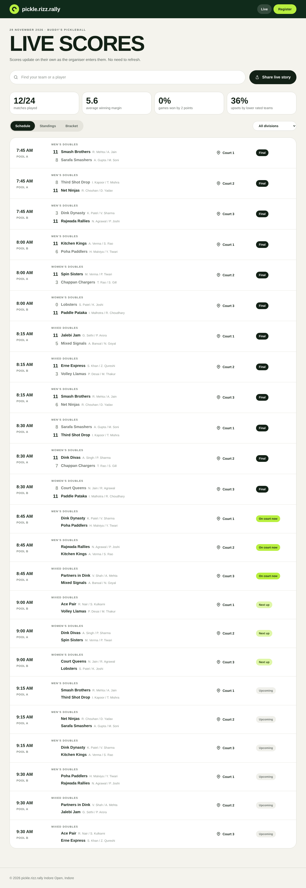
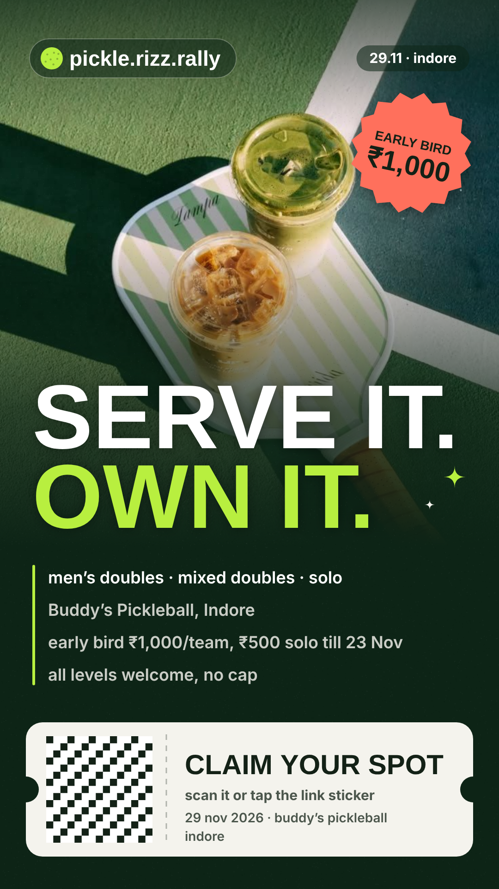

# pickle.rizz.rally: Indore Open

A live tournament site for a pickleball event at Buddy's Pickleball Junction, Indore, on 29 November 2026. Players register and pay by UPI from their phones, follow real-time scores, standings and brackets, and share Instagram-ready stories. The organiser runs the whole day from one dashboard.

**Live site:** https://picklerizzrally.github.io/

## What it does

| For | Features |
|---|---|
| Players | Two categories (Doubles and Solo), registration with in-form UPI payment and a payment screenshot or UTR, early bird pricing that switches on its own, live schedule with "On court now" and "Next up", pool standings, knockout bracket, team search, a page per team with their next court and time |
| Organiser | Login, approve or reject registrations with the fee due shown, WhatsApp confirmations, walk-ins, check-in, one-click schedule, score entry with rule checks, automatic knockout bracket with a 3rd place match |
| Instagram | One tap creates a 1080 x 1920 story with a QR code: registrations open, last few spots, schedule dropped, live now, team results, champions |

## How it works

**Stack:** React 19, TypeScript, Tailwind CSS v4, Vite, Firebase (Firestore and Authentication), GitHub Pages with GitHub Actions.

**Live data.** The whole tournament lives in one Firestore document. Every phone holds one live listener, so a score change costs one write and one read per viewer, which keeps a busy day inside the free tier. Phone numbers and emails sit in a separate collection that only the organiser can read.

**No overwrites.** Every organiser change runs inside a Firestore transaction, so two organisers entering scores on different courts never wipe each other's work.

**Scheduling engine** (`src/lib/tournament.ts`, pure TypeScript):

1. *Snake seeding* spreads strong entries across pools (A, B, C, then C, B, A).
2. *Circle method round robin* creates every pairing in each pool exactly once.
3. *Greedy court packer* fills every court in every slot and avoids back-to-back games where it can.
4. *Standings* rank by wins, then head to head for two-way ties, then point difference, then points scored.
5. *Knockouts* use standard seeding with byes, swap first-round opponents to avoid same-pool rematches, add a 3rd place match for Doubles, and schedule every final in the last block of the day.

**Payments.** The form builds a standard UPI payment link with the right amount for the category and date, so GPay, PhonePe or Paytm open with everything filled in. On a laptop the same link shows as a QR code.

**Built not to crash.** The last scores stay on screen if a player loses signal, storage falls back to memory in in-app browsers that block it, a crash shows a reload message instead of a blank page, and security rules validate every registration.

## Setup

1. **Firebase:** create a project, add a web app, create Firestore (asia-south1), turn on Email/Password sign-in, add an organiser user, paste `firestore.rules` with that user's UID, and add your GitHub Pages domain under Authorized domains.
2. **Event details:** edit `src/config.ts` for the Firebase keys, UPI ID, fees, prizes, perks, venue and WhatsApp numbers.
3. **Deploy:** push to `main`. The workflow in `.github/workflows/deploy.yml` builds and publishes to GitHub Pages.

Run locally with `npm install` then `npm run dev`.

## Pages

| Link | What it is |
|---|---|
| `/` | Home page |
| `#/register` | Home page with the registration form open (used by the story QR codes) |
| `#/live` | Schedule, standings, bracket and stats |
| `#/team/<id>` | One entry's matches and next court |
| `#/admin` | Organiser dashboard |

## Built by

Arnav Shahi. Contact for web creation on WhatsApp: [78699 66517](https://wa.me/917869966517)

UI designed in Figma Make.
